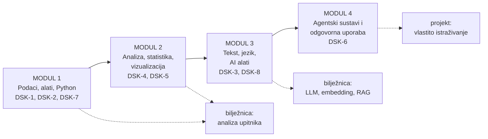

# Data Science u kulturi — materijali kolegija (2026./2027.)

**Od ankete do uvida: podaci, statistika i umjetna inteligencija u kulturološkim istraživanjima.**

Kolegij **Data Science u kulturi** — 5 ECTS, zimski semestar. Studij: **Sveučilišni prijediplomski studij Kulturologija (jednopredmetni)**, Filozofski fakultet u Rijeci.
Nositelj: **izv. prof. dr. sc. Benedikt Perak**.


Ovaj repozitorij je **radna knjiga kolegija**: dvanaest nastavnih cjelina, osam skripti, tri Colab bilježnice, projektni okvir i izvedbeni plan. Sve što je u njemu radi se na stvarnim podacima iz kulturoloških istraživanja — od studentskih anketa do korpusa i zbirki kulturne baštine.

Nastava se izvodi **koncentrirano u prva dva tjedna zimskog semestra** (znanstveno usavršavanje u 2026./2027.), a materijali su složeni tako da ih možeš proći i sam, korak po korak.

---

## Počni ovdje

| Ti si… | Kreni odavde |
|---|---|
| **student na nastavi** | Otvori bilježnicu [Analiza upitnika — jednostavna verzija](https://colab.research.google.com/github/bperak/dsk/blob/main/colab/DSK_analiza_upitnika_jednostavno.ipynb) i radi uz predavanje |
| **student koji uči sam** | Čitaj cjeline [`content/`](content/) redom (1 → 12); uz svaku je skripta koja se pokreće u Colabu |
| **predavač ili kolega** | Vidi [izvedbeni plan](docs/IZVEDBENI-PLAN.md) i [kako koristiti materijale](docs/KAKO-KORISTITI.md) |
| **radiš projekt** | [Upute za projekt](projekt/UPUTE_PROJEKT.md) · [predložak prijedloga](projekt/PRIJEDLOG_TEMPLATE.md) · [primjeri iz prošlih godina](projekt/PRIMJERI_IZ_PROSLIH_GODINA.md) |
| **zanima te samo AI dio** | Cjeline [08 LLM](content/08_llm_alati.md), [09 embedding](content/09_embedding_pretraga.md), [10 RAG](content/10_rag.md), [11 agenti](content/11_agenti.md) i AI sloj u [duljoj bilježnici](https://colab.research.google.com/github/bperak/dsk/blob/main/colab/DSK_analiza_upitnika_Rijeka.ipynb) |

---

## Put kroz kolegij

Četiri modula kolegija (5 ECTS, 150 sati: 45 sati nastave + 105 sati samostalnog rada) vode od pitanja do odgovora — i svaki modul završava nečim što možeš pokazati.



**Ishodi učenja kolegija (DSK-1 … DSK-8)**

| Kod | Ishod |
|---|---|
| DSK-1 | Opisati osnovne teorijske postavke znanosti o znanosti i teorijske pretpostavke kulturološki usmjerenih data-science metoda |
| DSK-2 | Navesti temeljne znanstvene metode i ocijeniti prikladnost istraživačkih metoda obzirom na vrstu podataka i cilj istraživanja |
| DSK-3 | Prepoznati, pretražiti i koristiti javne data-science alate i podatkovne resurse, uključujući AI alate |
| DSK-4 | Objasniti i primijeniti tehnike analize, dohvaćanja, pripreme i pohrane podataka |
| DSK-5 | Analizirati kvantitativne i kvalitativne tipove podataka te primijeniti postupke statističke analize |
| DSK-6 | Kritički vrednovati rezultate, metode i tehnike analize podataka, uključujući rezultate AI alata |
| DSK-7 | Svladati osnovne statističko-analitičke funkcije data-science programa (Python, Pandas, Google Colab) |
| DSK-8 | Koristiti praktične vještine znanstvenih metoda digitalne humanistike uz primjenu velikih jezičnih modela |

---

## Sadržaj repozitorija

### 📖 Nastavne cjeline (`content/`) — čitaj redom

Kolegij je AI-first: klasične metode (Pandas, statistika, vizualizacija) i suvremeni AI sloj (LLM, embedding, RAG, agenti) idu zajedno.

| # | Cjelina | Što dobivaš |
|---|---------|-------------|
| 01 | [Uvod: data science u kulturi](content/01_uvod_data_science_u_kulturi.md) | istraživački proces u 8 koraka, od pitanja do izvještaja |
| 02 | [Podaci u kulturi: vrste, FAIR, AI-spremnost](content/02_podaci_fair_ai.md) | kako prepoznati dobar podatak i zašto je metapodatak pola posla |
| 03 | [Python i Google Colab](content/03_python_colab.md) | prvi kod bez instaliranja — u pregledniku |
| 04 | [Pandas — tablični podaci](content/04_pandas_tablice.md) | učitavanje, čišćenje i spajanje anketa, kataloga i popisa |
| 05 | [Statistika — deskriptivna analiza i korelacije](content/05_statistika.md) | sredine, raspršenje, povezanost i njihove granice |
| 06 | [Vizualizacija](content/06_vizualizacija.md) | slika koja ne vara i koju svi razumiju |
| 07 | [NLP — obrada tekstualnih podataka](content/07_nlp_tekst.md) | frekvencije, kolokacije, čišćenje korpusa |
| 08 | [LLM u podatkovnoj znanosti](content/08_llm_alati.md) | klasifikacija, ekstrakcija, sažetak — uz provjeru |
| 09 | [Embedding i semantička pretraga](content/09_embedding_pretraga.md) | pretraga po značenju, ne po ključnoj riječi |
| 10 | [RAG — razgovor s kulturnom baštinom](content/10_rag.md) | odgovori utemeljeni u dokumentima, s izvorom |
| 11 | [Agentski sustavi](content/11_agenti.md) | istraživač koji sam traži, provjerava i zapisuje |
| 12 | [Etika i kritičko vrednovanje AI rezultata](content/12_etika_ai.md) | kada vjerovati modelu, a kada vlastitom izračunu |

Svaka cjelina ima isti oblik: **uvod i ishode → teoriju s primjerima → ključne pojmove → provjeru razumijevanja → praktične zadatke (🟢🟡🏆) → put dalje**.

### 💻 Skripte (`scripts/`) — isti posao izvan Colaba

| # | Tema | Skripta |
|---|------|---------|
| 1 | Pandas — tablični podaci | [`01_pandas_osnove.py`](scripts/01_pandas_osnove.py) |
| 2 | Statistika i korelacije | [`02_statistika_korelacije.py`](scripts/02_statistika_korelacije.py) |
| 3 | Vizualizacija | [`03_vizualizacija.py`](scripts/03_vizualizacija.py) |
| 4 | NLP obrada teksta | [`04_nlp_obrada_teksta.py`](scripts/04_nlp_obrada_teksta.py) |
| 5 | LLM analiza (klasifikacija, ekstrakcija, sažetak) | [`05_llm_analiza.py`](scripts/05_llm_analiza.py) |
| 6 | Semantička pretraga (embedding) | [`06_semanticka_pretraga.py`](scripts/06_semanticka_pretraga.py) |
| 7 | RAG — razgovor s kulturnom baštinom | [`07_rag_kulturna_bastina.py`](scripts/07_rag_kulturna_bastina.py) |
| 8 | Agent istraživač (Google ADK) | [`08_agent_istrazivac.py`](scripts/08_agent_istrazivac.py) |

Skripte 05–08 traže Gemini ključ (besplatan) i to jasno pišu na početku; skripte 01–04 rade bez ijednog ključa.

### 🧪 Colab bilježnice (`colab/`) — klik i radi

| Bilježnica | Za koga | Što radi |
|---|---|---|
| [Analiza upitnika — jednostavna verzija](https://colab.research.google.com/github/bperak/dsk/blob/main/colab/DSK_analiza_upitnika_jednostavno.ipynb) | svi | **pravi podaci** iz objavljene tablice; osam koraka od učitavanja do sažetka; predložak za vlastiti upitnik |
| [Analiza upitnika — puna verzija](https://colab.research.google.com/github/bperak/dsk/blob/main/colab/DSK_analiza_upitnika_Rijeka.ipynb) | nakon prvih koraka | isto + preklapanje odgovora, korelacije, žanrovi preko modela, semantička sličnost ukusa, sažetak koji piše model |
| [`DS_KULT_Podatkovna_znanost_u_kulturi.ipynb`](colab/DS_KULT_Podatkovna_znanost_u_kulturi.ipynb) | za cijeli kolegij | AI-first pipeline: FAIR → Pandas + LLM → embedding → RAG → agenti → etika |

### 🎓 Projekt (`projekt/`)

| Dokument | Čemu služi |
|---|---|
| [Upute za projekt](projekt/UPUTE_PROJEKT.md) | faze, rokovi, ocjenjivanje, pravila za AI alate |
| [Predložak prijedloga](projekt/PRIJEDLOG_TEMPLATE.md) | format **Domena / Problem / Cilj** s primjerima |
| [Primjeri iz prošlih godina](projekt/PRIMJERI_IZ_PROSLIH_GODINA.md) | kako su studenti definirali teme (2021/22 – 2025/26) |

### 📚 Ostala dokumentacija

| Dokument | Sadržaj |
|---|---|
| [Izvedbeni plan](docs/IZVEDBENI-PLAN.md) | moduli, ishodi, tjedni, što se ocjenjuje i gdje se što nalazi |
| [Kako koristiti materijale](docs/KAKO-KORISTITI.md) | tri načina rada (Colab, lokalno, predavač), ključ za AI, rješavanje problema |
| [Pojmovnik](docs/POJMOVNIK.md) | svi ključni pojmovi kolegija na jednom mjestu |
| [Mreža triju knjiga](docs/MREZA-KNJIGA.md) | gdje je što kanonski izloženo i kako se materijali citiraju |
| [Plan knjige](book/KNJIGA_PLAN.md) | struktura i status knjige *Data Science u kulturi* koja raste iz kolegija |

---

## Kako pokrenuti

**U Colabu (preporučeno, ništa se ne instalira).** Klikni bilježnicu iz tablice iznad; Colab je otvara s GitHuba. Za AI korake treba ti **vlastiti besplatni ključ**: [Google AI Studio](https://aistudio.google.com) → *Get API key*, pa ga spremi u Colabu kao tajnu pod imenom `GOOGLE_API_KEY` (ikona ključa u lijevoj traci). Kvota se mjeri po projektu, ne po ključu — zato svatko koristi svoj ključ.

**Lokalno (ako želiš raditi izvan Colaba).**

```bash
git clone https://github.com/bperak/dsk.git
cd dsk
python3 -m venv .venv && source .venv/bin/activate
pip install -r requirements.txt
python3 scripts/01_pandas_osnove.py
```

Ključni paketi koje `requirements.txt` donosi: `pandas`, `numpy`, `scipy`, `matplotlib`, `seaborn`, `nltk`, `scikit-learn`, **`google-genai`** (jezični model i embedding) i **`google-adk`** (agentski sustavi). Bez njih rade skripte 01–04; s njima i skripte 05–08.

Za AI skripte postavi ključ u okolinu:

```bash
export GEMINI_API_KEY="tvoj-kljuc"
python3 scripts/05_llm_analiza.py
```

**Provjera da sve radi** (materijali imaju i vlastite testove):

```bash
python3 -m pytest tests/ -q
```

---

## Rad s AI alatima — pravila kolegija

AI je u ovom kolegiju alat, ne autor. Uz modele koje pozivamo iz koda (Gemini preko `google-genai`), u nastavi koristimo i **NotebookLM** — alat koji radi kao RAG: odgovara isključivo iz predanih izvora i citira ih (od srpnja 2026. nosi ime *Gemini Notebook*). Uči se na njemu kako RAG izgleda izvana, a citati se provjeravaju kao i svaki drugi izvor.

- ✅ **Dopušteno:** korištenje modela za pomoć pri pisanju pitanja, čišćenju podataka, analizi otvorenih odgovora, sažimanju i provjeri koda.
- ⛔ **Obavezno:** svaku upotrebu AI alata **navesti u metodologiji** (koji alat, za što, s kojim zadatkom).
- ⛔ **Zabranjeno:** predstavljati AI-generirani tekst kao vlastiti bez navoda; izmišljati podatke ili ankete.

Praktično pravilo koje vrijedi i u istraživanju i u nastavi: **model smije pisati tekst, ali brojke i zaključke provjeravaš sam** — i svaka brojka u tekstu mora se naći u tablici.

---

## Mreža triju knjiga

Ovi materijali nisu samostalan projekt, nego dio mreže triju knjiga autora.

| Knjiga | Pitanje na koje odgovara | Što joj pripada |
|---|---|---|
| *Komunikacija u doba umjetne inteligencije* (2025) | **što se dogodilo** | povijest komunikacije, arhitektura i obuka LLM-a, promptanje |
| **Data Science u kulturi** (ovi materijali) | **kako se mjeri** | podaci i FAIR, Pandas, statistika, vizualizacija, NLP, embedding, RAG, agenti |
| *Razine i entiteti: ontologija komunikacije u doba umjetne inteligencije* (u izradi) | **gdje to ontološki stoji** | sustavi i razine, emergencija, model kao entitet |

Detalji i kanonski izvori: [`docs/MREZA-KNJIGA.md`](docs/MREZA-KNJIGA.md) · zajednički registar pojmova: [pojmovnik mreže](https://github.com/bperak/OntologijaKomunikacijeUDobaAI/blob/main/pojmovnik/RJECNIK.md)

**Temeljni resurs kolegija**

> Perak, B. (2025). *Komunikacija u doba umjetne inteligencije: Razvoj velikih jezičnih modela i komunikacijskih agenata*. Rijeka: Filozofski fakultet u Rijeci. ISBN 978-953-361-147-1 — [otvoreni pristup](https://github.com/bperak/komunikacija_u_doba_ai)

---

## Kako citirati

> Perak, B. (2026). *Data Science u kulturi — materijali kolegija*. Filozofski fakultet u Rijeci. https://github.com/bperak/dsk

```bibtex
@misc{perak_dsk_materijali,
  author = {Perak, Benedikt},
  title  = {Data Science u kulturi — materijali kolegija},
  year   = {2026},
  note   = {Sveučilišni prijediplomski studij Kulturologija, Filozofski fakultet u Rijeci},
  url    = {https://github.com/bperak/dsk}
}
```

---

## Literatura i resursi

- Perak, B. (2025). *Komunikacija u doba umjetne inteligencije*. FFRI Rijeka. (otvoreni pristup)
- Grus, J. (2019). *Data Science from Scratch*. O'Reilly.
- Bommasani, R. et al. (2021). *On the Opportunities and Risks of Foundation Models*. arXiv:2108.07258
- Python za lingviste: https://github.com/nljubesi/python-for-linguists
- Alati: [Google Colab](https://colab.research.google.com) · [Google AI Studio](https://aistudio.google.com) · [Pandas](https://pandas.pydata.org/docs/) · [Matplotlib](https://matplotlib.org) · [Voyant Tools](https://voyant-tools.org) · [Recogito](https://recogito.pelagios.org)

---

## Napomena o korištenju

Materijali su nastavni materijali kolegija (**© Benedikt Perak, Filozofski fakultet u Rijeci**). Slobodno ih koristi u nastavi i istraživanju uz naveden izvor; za komercijalnu upotrebu i prijevode javi se autoru. Ako želiš formalnu licencu (npr. CC BY-NC-SA 4.0), otvori *Issue* i dodajemo je.

Materijali nastaju iz nastave i stalno se popravljaju. Uočiš li grešku, nejasan primjer ili zastario model — otvori *Issue* ili pošalji *Pull request*; studentske primjedbe iz prethodnih godina su ugrađene u upravo ove verzije.

**Kontakt:** izv. prof. dr. sc. Benedikt Perak · bperak@uniri.hr · [syntagent.com](https://syntagent.com)
